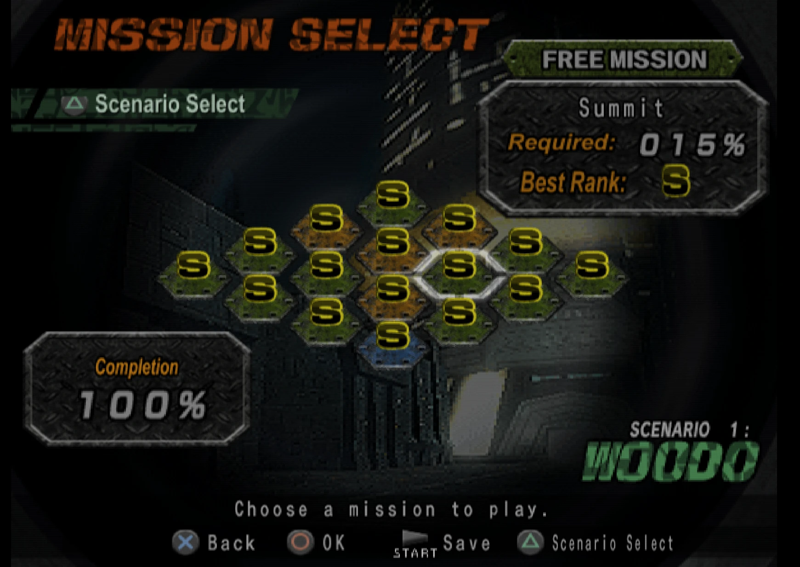
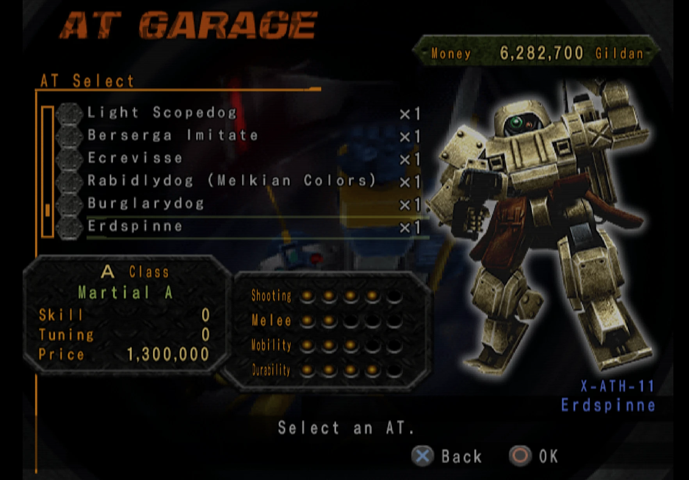
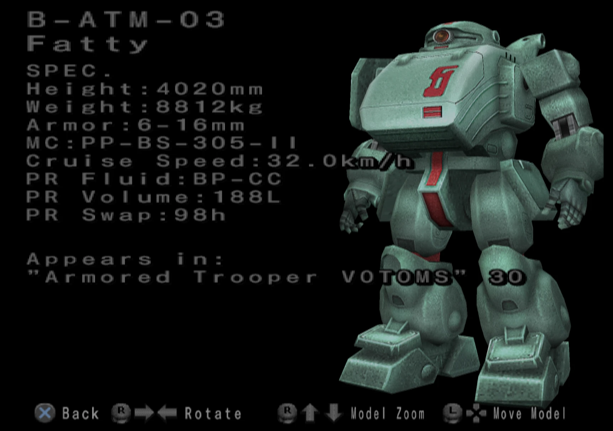
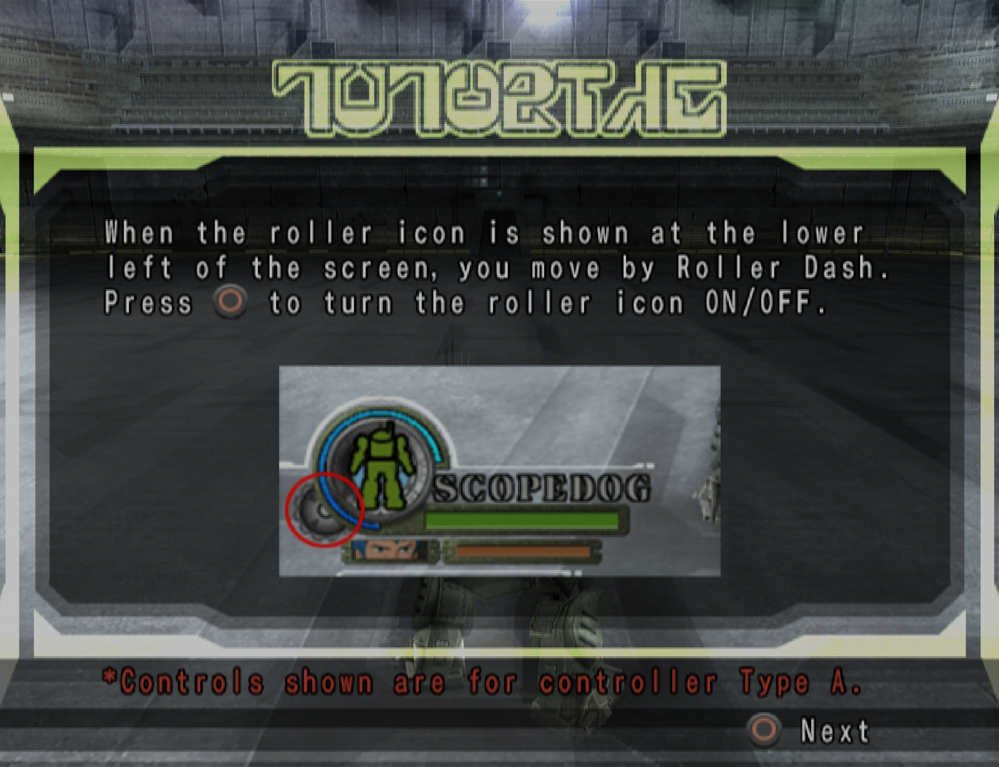
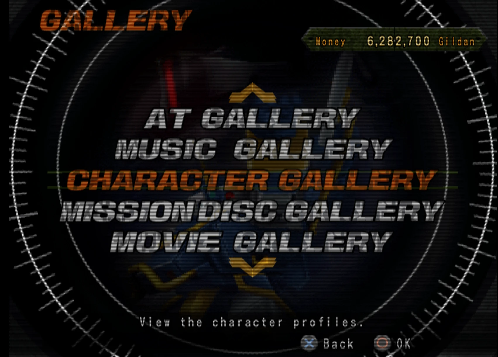
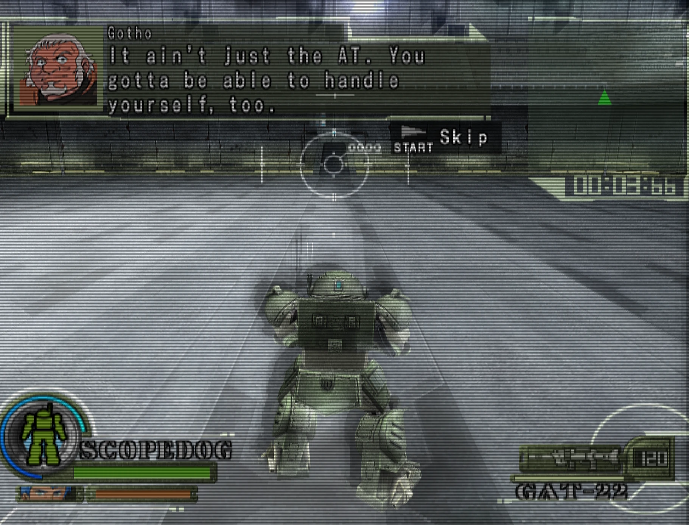

# Armored Trooper Votoms (PS2) — English Patch

A fan translation of **Soukou Kihei Votoms** (装甲騎兵ボトムズ), the Japan-only PlayStation 2 game (SLPS-25827).

**What's translated**

- All story dialogue, mission briefings and objectives
- Menus, options, the shop, AT parts and spec sheets
- Tutorials, memory card messages, the HUD and the credits
- Menu graphics: mission titles, scenario banners and the mission select / mission start labels (redrawn in plain English text)

**Still in Japanese:** the title-screen logo and a few captions inside the tutorial screenshots. Voices are untouched (Japanese audio).

> This patch does **not** include the game. You need your own copy of the Japanese disc, ripped as an ISO.

## Screenshots

| | |
|---|---|
|  |  |
|  |  |
|  |  |

---

## How to patch the game (Windows, about 5 minutes)

### 1. Get the files

- **The patch:** download `Votoms-English-v1.1.xdelta` from the [Releases page](../../releases) (it's also in the [`patch`](patch) folder).
- **Delta Patcher**, a free patching tool: download it from <https://github.com/marco-calautti/DeltaPatcher/releases> and unzip it anywhere.
- **Your game ISO:** `Soukou Kihei Votoms (Japan).iso`. If it's inside a `.7z` or `.zip`, extract it first.

### 2. Check that your ISO is the right one (don't skip this)

The patch only works on this exact dump of the game, and the patching tool can't tell if you give it a different one. You'd just get a broken game. To check yours, open **PowerShell** (press Start and type `powershell`), then run this, with your ISO's real path:

```powershell
Get-FileHash -Algorithm MD5 "C:\path\to\Soukou Kihei Votoms (Japan).iso"
```

The result should be:

| | |
|---|---|
| **MD5** | `5487EB7A234301DD3932174446EF9BCD` |
| CRC32 | `6EB0151C` |
| SHA-1 | `d261afc190fff74f7f600bc1cc3e8cbeda046fa6` |
| Size | 4,400,807,936 bytes |

If it doesn't match, don't patch it. See [Troubleshooting](#troubleshooting).

### 3. Apply the patch

1. Open **DeltaPatcher.exe**.
2. **Original file:** click the folder icon and pick your Japanese ISO.
3. **XDelta patch:** pick `Votoms-English-v1.1.xdelta`.
4. Click **Apply patch**. It takes a minute or two.

Delta Patcher changes the ISO you selected **in place**. Make a copy first if you want to keep the Japanese version (or tick *Backup original file* in the options ⚙).

When it finishes, the ISO is the English version. Rename it to something like `Votoms (English).iso` if you like.

### 4. Play

Open the patched ISO in **PCSX2** like any other game (*System → Boot ISO*). The game is the same size as the original, so it should also work anywhere the original works.

---

## Mac / Linux

Install `xdelta3` (Homebrew: `brew install xdelta`, Debian/Ubuntu: `sudo apt install xdelta3`), then run:

```sh
xdelta3 -d -s "Soukou Kihei Votoms (Japan).iso" Votoms-English-v1.1.xdelta "Votoms (English).iso"
```

---

## Troubleshooting

- **The patch fails, or the game crashes / shows garbage after patching:** your ISO is a different dump or was modified. The patch needs an unmodified Japanese ISO with the MD5 above.
- **My game is `.bin` / `.cue` or `.chd`:** convert it to a plain `.iso` first (e.g. with `chdman extractdvd` for CHD files), then check the MD5.
- **I already patched it once:** patching an already-patched ISO fails. Start again from a clean Japanese ISO.
- **Patched ISO MD5** (to confirm it worked): `09404A90F5F52F3BD409187C38E8B5F3`.

Found a typo, an untranslated line, or text running off the screen? Please [open an issue](../../issues) with a screenshot and where it happened.

---

## Changelog

- **v1.1**:
  - Fixed Yes/No choices being invisible on prompts (controls tutorial, memory card messages).
  - Translated the leftover "進む" (Next) button and the battling and mission results screens.
  - Translated the in-mission options and some enemy and weapon names.
- **v1.0**: First release.

## For translators and developers

The translation lives in plain text files (`work/en/*.tsv`), and the patch is rebuilt from them with Python scripts. See [BUILDING.md](BUILDING.md).

## Legal

This is an unofficial fan project, not affiliated with or endorsed by the game's publishers or rights holders. No game data is distributed here. The patch only contains the differences needed to translate a copy you already own.
